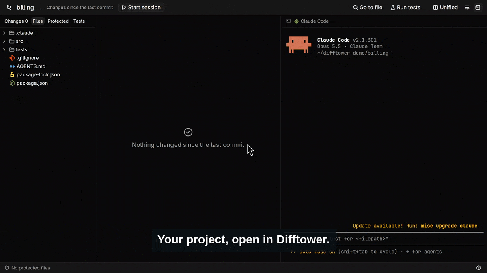

# Difftower

**A control tower for coding agents.** Difftower is a fast, native diff
monitor for the way code gets written now: an agent edits, you supervise.



[Watch the full demo](https://difftower.com/demo.mp4) · [difftower.com](https://difftower.com)

It is not an editor. It shows, live, everything your agents changed
against HEAD, lets you read it file by file, guards the files agents must
not touch and runs your tests. Locally or on a server over SSH, one
repository or several at once.

## Features

- **Live diff of your repo.** Everything that differs from HEAD, untracked
  files included, updated as the agent writes.
- **Read it like a pull request.** The selected file is shown in full with
  its changes, next to a minimap of the file with its changes tinted and
  the part in view boxed, as in VS Code; click or drag it to move. `+`/`−`
  counts per file. Unified or split view (each side scrolls sideways on its own)
  and syntax highlighting. There is nothing to approve: a change is
  accepted when you commit it.
- **File tree.** Browse every file in the repository, see which folders
  contain changes, and open unchanged files read-only, or jump to any file
  with `Ctrl+P`.
- **Protected files and folders.** Protect tests, migrations or whole
  folders from the tree. The status bar turns red the moment an agent
  touches one, with a single count however many files it hit, and the
  Protected tab lists each rule with what changed under it. Revert one
  file, one rule or everything in a click; the alert stays until the
  change is reverted or committed.
- **Tests.** Run every test, a folder, a file or a single test, the ones
  that failed, or the ones for the files that changed. See below.
- **Revert any file** to HEAD.
- **Integrated terminal** to run your agent right next to its diff.
- **Notifications.** While the window is in the background, a desktop
  notification tells you when an agent touches a protected file or a test
  fails (through `notify-send`).

### Tests

The Tests tab lists the tests of every repository by folder and file.
Hover a row and press ▶ to run it, or use the buttons at the top of the
tab:

- ▶ runs everything (also **Run tests** in the toolbar),
- ↺ runs again the tests that failed (also **Re-run failed** in the status
  bar),
- the diff icon runs the tests of the changed files: a changed test file,
  and the tests named after a changed file (`user.rb` brings
  `user_test.rb`, `test_user.py` or `user.test.ts`).

The runner's output streams into the center panel. Click a failed test to
see only what the runner said about it, and **Open** to go to it in its
file. The status bar turns red when a test fails. Results are kept per
repository in `~/.local/state/difftower/tests/` for the next session.

Difftower runs pytest, vitest and Rails (minitest) tests, finding each
from the project's files and running it as a terminal at the repository
root would: `.venv/bin/python -m pytest`, `node_modules/.bin/vitest` or
`bin/rails test`. Commands run in an interactive login shell, so version
managers set up in `~/.bashrc` (rbenv, pyenv, nvm) apply. To choose the
runner or its command, add to `.difftower.toml`:

```toml
[tests]
runner = "rails"   # pytest, vitest or rails
command = "PARALLEL_WORKERS=2 nice -n 19 bin/rails test"
```

### Protected files

Protected paths live in `.difftower.toml` at the repository root, so a
team can commit and share them:

```toml
[guard]
protect = ["tests/**", "migrations/**", "Cargo.lock"]
```

As in `.gitignore`, a rule starting with `!` is an exception and the last
matching rule wins:

```toml
[guard]
protect = ["tests/**", "!tests/fixtures/scratch.json"]
```

The shield next to a file or folder in the tree works like a checkbox:
a folder is fully, partly or not protected, clicking it protects or
unprotects everything inside, and unprotecting a single file inside a
protected folder adds an exception. Difftower keeps the rule list minimal
as you click. The Protected tab lists the files each rule covers.

## Your preferences

Panel widths, unified or split diffs, wrapping and whether the terminal
is shown are kept per user in `~/.config/difftower/settings.json`
(`$XDG_CONFIG_HOME` is honored), separate from the repository's
`.difftower.toml`. Drag the dividers to resize: the file list and the
terminal keep their width and the diff takes the rest.

## Keyboard

| Keys | Action |
| --- | --- |
| `Ctrl+1` | Changes |
| `Ctrl+2` | Files |
| `Ctrl+3` | Protected |
| `Ctrl+4` | Tests |
| `Ctrl+P` | Go to file |
| `j` / `k` | Next / previous changed file |
| `n` / `p` | Next / previous change |
| `Alt+Z` | Wrap long lines |
| ``Ctrl+` `` | Move between the terminal and the diff |
| `Ctrl+Shift+T` | Run every test |
| `?` / `F1` | How Difftower works, and these keys |

On Omarchy, Super+C and Super+V copy and paste in the terminal once
Hyprland takes Difftower for a terminal; add to `~/.config/hypr/hyprland.lua`:

```lua
o.window("difftower", { tag = "+terminal" })
```

`Ctrl+P` and the single letters work when the focus is outside the terminal,
which keeps them for the shell: click the file list or the diff first.

## Updates

When a newer release is out, the status bar says so. If Difftower is
installed where you can write, as `install.sh` does in `~/.local/bin`,
**Update** downloads it, checks it against its published checksum and puts
it in place, then **Restart** runs it; installed system-wide, run the
installer again. The check is one request to GitHub's releases API on
start, nothing else is sent, and `"check_updates": false` in
`~/.config/difftower/settings.json` turns it off.

## Several repositories at once

Open a directory that is not a repository but holds some, such as
`~/repos` with `api/`, `web/` and `worker/` inside, and Difftower shows
all of them in one workspace, every path under its repository's name. No
`git init` in the parent is needed. Each repository keeps its own
`.difftower.toml`, so its protections and tests also apply when it is
opened alone. Repositories are found one level down. The parent may be a
repository too, as when it keeps notes beside code repositories it
ignores: it shows alongside them.

## Remote repositories over SSH

```sh
difftower user@host:/path/to/repo
difftower myserver:~/code/app      # any host from ~/.ssh/config
```

Difftower uses your own `ssh`, so keys, `~/.ssh/config`, `ProxyJump` and
the rest work as usual. On first connection it installs a small static
agent (about 3 MB, a few MB of RAM) in `~/.cache/difftower/` on the host;
the agent watches the repository there and sends only diffs. Each
Difftower version carries its matching agent and replaces the old one on
the next connection, so there is nothing to install or update by hand.
The terminal opens a shell on the host in the repository, so agents run
there. All of it shares one SSH connection.

If the connection drops, Difftower reconnects in the background, waiting
longer between attempts (up to 30 s), and refreshes once it is back; the
terminal opens a new session too. Programs running in the old remote
session end with it, so run long-lived agents inside `tmux` on the host to
pick them up again.

Requirements on the host: Linux x86_64 and git. Authentication must not
prompt (use a key or an SSH agent).

## How it works

The working tree, untracked files included, is written as a git tree
through a private index file (`.git/difftower/index`) and diffed against
HEAD. Your own index, branches and stash are never touched.

## Credits

File icons come from [Material Icon Theme](https://github.com/material-extensions/vscode-material-icon-theme)
(MIT), see `crates/difftower/assets/file-icons/LICENSE`.

## Building

Requires Rust 1.90+, git, and clang with lld for linking. Linux only for
now.

```sh
cargo dt                     # start screen with recent repositories
cargo dt path/to/repo        # open a local repository
cargo dt user@host:/repo     # open one over SSH
```

`cargo dt` builds the `profiling` profile: as fast as release at runtime,
but incremental, so a change rebuilds in seconds. `cargo build --release`
adds LTO for the shipped binary and takes minutes after any change; use it
only to package (`./target/release/difftower`).

Without arguments Difftower shows a start screen: type a path or
`user@host:/path`, choose a folder, or reopen a recent repository. The icon
at the top left of a workspace goes back to it.

## Roadmap

- [x] Live diff against HEAD, protected files
- [x] Integrated terminal to run agents side by side
- [x] Remote folders over SSH via a tiny server-side agent
- [x] Several repositories in one workspace
- [x] Tests: pytest, vitest and Rails
- [ ] More test runners: cargo, jest, RSpec, go
- [ ] Line comments sent back to the agent as prompts
- [ ] Agent hooks that block edits to protected files before they happen
- [ ] Several agents / git worktrees at once
- [ ] macOS

## License

Licensed under either of [Apache License 2.0](LICENSE-APACHE) or
[MIT license](LICENSE-MIT) at your option.
